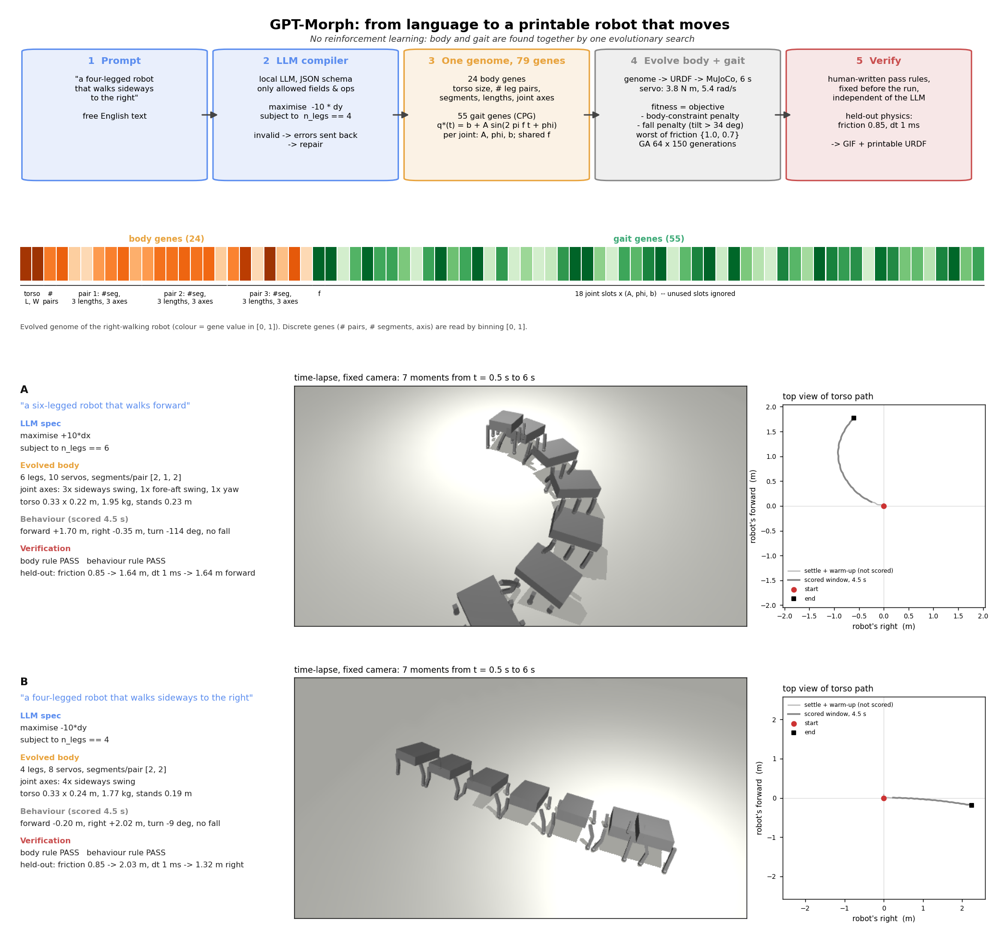

# GPT-Morph

From a sentence to a verified, printable robot, in simulation. A small language model turns a free-text request into a
design spec; one evolutionary search then finds the robot's body and its gait together; a rule written before the run
decides whether the result does what the sentence said.

Nam H. Le, University of Vermont. [drnamlabs.com](https://drnamlabs.com)

Early work. Everything here is tested in MuJoCo only, one seed per sentence, no hardware.

## Pipeline



1. **Prompt**: free text, any language.
2. **Compiler**: Qwen2.5-1.5B-Instruct with a LoRA adapter writes a JSON spec: a behaviour objective (weights on forward,
   sideways, turning, airtime, travel) and body constraints (number of legs, leg length, mass).
3. **One genome, 79 genes**: 24 body genes (torso size, leg pairs, segments, lengths, joint axes) and 55 gait genes
   (a sine per joint: amplitude, phase, offset; one shared frequency).
4. **Evolve body and gait together** in MuJoCo (genetic algorithm, 64 x 150 generations, DC-servo model with back-EMF).
   No reinforcement learning. Fitness is the spec's objective, minus body-constraint and fall penalties, taking the worst
   of two friction settings.
5. **Verify** with pass rules written before the run (`step2_morph/intent_checks.json`), on held-out physics.

## Language layer: training

`step2_morph/lora_data.py` builds 703 training sentences: templated requests plus paraphrases written by a local 27B model
for each (direction, body) class. Labels come from the class that was asked for, never from a model-written spec. Words
that appear only in the test set are banned and any sentence too close to a test sentence is dropped, so the 23 scored
test sentences stay unseen. Training is English only; `lora_train.py` runs 3 epochs, batch 8, learning rate 2e-4, LoRA
r=16, alpha=32 on the attention projections.

| Compiler (23 unseen sentences, rules fixed before scoring) | Body right | Direction right | Both |
|---|---|---|---|
| 27B model, zero-shot, hand-written prompt | 23/23 | 11/23 | 11/23 |
| Sentence embeddings + MLP | 15/23 | 14/23 | 11/23 |
| Qwen2.5-1.5B + LoRA | 18/23 | 21/23 | 16/23 |

The 27B model understands the words but flips the sign of the sideways axis in about half the cases. The LoRA model fixes
the sign, handles negation and Vietnamese (never seen in training), and fails on words it has not seen (biped, insect).

## Results

Four robots from four sentences in three languages, each passing its pre-written checks in MuJoCo (seed 0):

| Sentence | Evolved body | Behaviour (4.5 s scored) |
|---|---|---|
| a six-legged robot that walks forward | 6 legs, 10 servos | 1.70 m forward |
| a four-legged robot that walks sideways to the right | 4 legs, all joints on the x axis | 2.02 m to the right |
| un robot che gira su se stesso | 4 legs, z-axis joints | 647 degrees on the spot |
| un robot aux longues jambes qui saute | 2 long legs, lightest torso | 59% of the time airborne |

The sentences never mention joints, but the behaviour pulls the joint structure with it: sideways walking selects x-axis
joints, spinning selects z-axis joints, hopping selects two long legs and a light torso. One seed per sentence, so
observations, not conclusions. Clips of each run are in `media/`.

The verification step caught six exploits of the simulator along the way, all fixed: joint speeds beyond the servo limit,
soft default contacts, falling forward counted as walking, a single lunge counted as a gait, one jump then a fall scored
as 100% airtime, and flickering foot contacts counted as flight.

## Limits

Tested in MuJoCo only, one seed per sentence, no hardware. Transfer to another simulator (sim-to-sim) and to a real
robot (sim-to-real) has not been verified; both are future work. Compiler labels are a hand-written dictionary; closing
the loop so labels come from physically verified specs is not done.

## Related work

- Ringel, Charlick, Liu, Xia, Chen. *Text2Robot: Evolutionary Robot Design from Text Descriptions.* ICRA 2025.
  [arXiv:2406.19963](https://arxiv.org/abs/2406.19963). Text sets the initial shape through a text-to-3D model; the
  body is then a fixed quadruped, the behaviour is always walking, and the text is not used again during optimisation.
  Here the text sets the behaviour and the body constraints throughout, and the result is checked against the sentence.
  The module sizes and URDF conventions in `morph.py` follow its open-source release.

## Setup

```bash
git clone https://github.com/drnamlabs-gif/gpt-morph.git
cd gpt-morph
git clone https://github.com/generalroboticslab/Text2Robot.git   # robot modules and the example URDF, kept at the repo root
python -m venv .venv && source .venv/bin/activate                # or a conda env with Python 3.11
pip install -r requirements.txt
```

- The evolution and the verification (`step2_morph/evolve_morph.py`, `verify.py`) run on CPU and need only MuJoCo.
- The prompt compiler used to write specs and training paraphrases is a local model served by
  [Ollama](https://ollama.com) at `http://localhost:11434` (`qwen3.6:latest`, see `compiler.py`). It is only needed to
  regenerate `lora/train.jsonl` and the zero-shot baseline.
- LoRA training (`lora_train.py`) needs a GPU; the adapter itself is not included, so run `lora_data.py` then
  `lora_train.py` to reproduce it.
- Text2Robot is distributed under its own licence; the version used here is commit `1203e87`.

Scripts, roughly in order: `python step2_morph/lora_data.py`, `lora_train.py`, `lora_grade.py`, then `run_all.py` to evolve and verify
the demo robots and `story.py` to render the clips.

## Layout

- `step1_frog_cpg/`: a fixed frog body, a gait search, and the first paraphrase test.
- `step2_morph/`: body generator (`morph.py`), compiler (`compiler.py`, `lora_*.py`, `student.py`), evolution
  (`evolve_morph.py`), verification (`verify.py`), prompts and checks (`*.json`), figures.
- `media/`: compact clips of each run.

The Text2Robot repository is not vendored; clone it into the repo root as shown under Setup.
